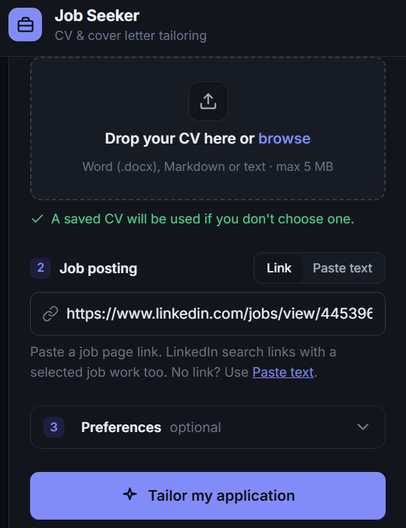
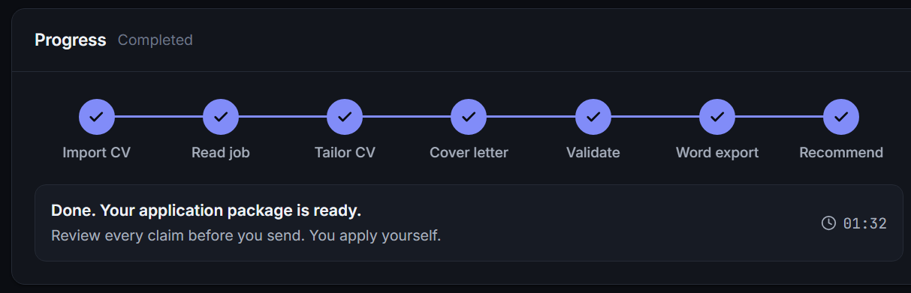
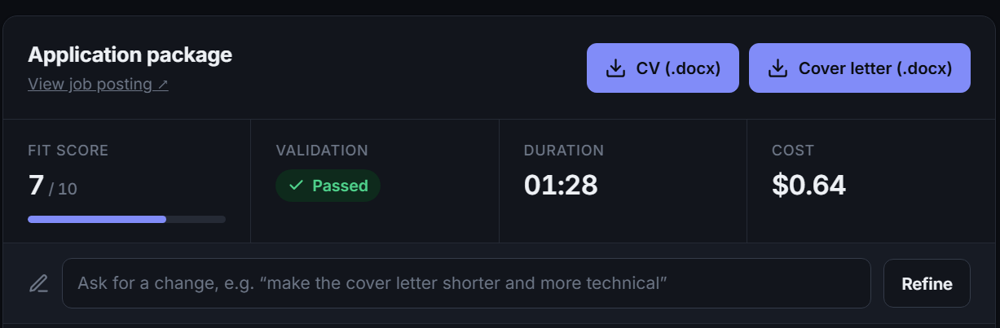

# Job Seeker

A Claude Code skill, with a local web UI, that tailors your CV and a cover letter to a job posting, checks them against your original CV, exports both to Word, and ranks how well you fit the job.

**It never applies or sends anything.** It only writes files. You review them and send applications yourself.

> **Where is the skill?** In [.claude/skills/job-seeker/](.claude/skills/job-seeker/). The `job seeker skill/` folder holds only the design documents (PRD and tutorial). The app doesn't use it.

## Setup

Run the setup script for your system:

```powershell
.\setup.ps1          # Windows PowerShell (if blocked: powershell -ExecutionPolicy Bypass -File .\setup.ps1)
```

```bash
./setup.sh           # macOS, Linux, or Git Bash on Windows
```

The setup script:

1. **Checks the prerequisites.** It prints how to install anything that's missing (on Windows, as a `winget` command), and stops if a required one is missing:
   - Node.js 20 or newer (required)
   - Python 3 (required; it reads Word CVs using only the standard library)
   - Claude Code, with `claude` on your PATH and logged in (required)
   - Google Chrome (optional)
2. **Installs the skill's dependency.** This is the `docx` library for the Word export (`npm install --prefix .claude/skills/job-seeker`). The web UI itself has no dependencies.
3. **Runs the self-check** (`npm test`).

Then, optionally, run `claude` in this folder once, type `/mcp`, and approve `chrome-devtools` (configured in [.mcp.json](.mcp.json)) so jobs are read in a real browser.

The scripts don't install Node, Python, Chrome, or Claude Code for you. They only tell you what's missing.

### Why the Chrome MCP (optional)

It gives the skill a real Chrome browser to read job postings. Without it, the skill uses WebFetch.

| | Without (WebFetch) | With Chrome MCP |
| --- | --- | --- |
| Job text | Often a paraphrased summary | The full posting, word for word |
| JavaScript-built pages | Often empty or partial | Fully rendered |
| Search (`DevOps Engineer in Israel count 3`) | Not possible | Searches and opens the results |

Exact wording matters, because the CV is matched to the job's keywords and the validator checks fit against the full requirements. A single public job URL works without the Chrome MCP, and so does pasted job text. Searching job boards needs it.

**The browser runs hidden (headless).** No Chrome window opens during a run. Public job pages, including LinkedIn job links, work this way. If a page needs a login or a CAPTCHA, the run stops and tells you. Use *Paste text* instead, or, to log in yourself, remove `"--headless"` from [.mcp.json](.mcp.json) so the browser window becomes visible.

## Use the web UI

Start the server:

```powershell
.\start.ps1          # Windows
```

```bash
./start.sh           # macOS, Linux, Git Bash
```

`npm start` also works. To use another port, set `PORT` first (`$env:PORT = 4000` in PowerShell, or `PORT=4000 ./start.sh`). Stop the server with Ctrl+C.

Then open <http://localhost:3030> and follow these steps:

1. **Choose your CV.** Drag in a `.docx`, `.md`, or `.txt` file (*Upload*), or enter its location (*File path*), for example `C:\Users\you\Downloads\cv.docx`. Leave both empty to reuse your saved CV.
2. **Enter the job.**
   - *Link:* paste the job URL. A LinkedIn search link with a job selected (`currentJobId=...`) is converted to that job's own page.
   - *Paste text:* use this if you have no link or the page can't be read. Paste the full job description. It is saved to `input/pasted_job.md`, and no browser is needed.
3. Optional: open **Preferences**.
   - Profile text (tone, must-mention items, companies to avoid), saved to `cv/profile.md`.
   - **Max fix rounds** (1–3, default 2): how many times the validator may send the CV and letter back for fixes.
   - **Budget limit** (USD, default 3): a hard spending cap for the run.

   

4. Click **Tailor my application**. The 7 pipeline steps light up as the skill runs, with a timer. The activity log shows each action.

   

5. Review the results:
   - Fit score, validation result, time, and cost.
   - Tabs: Overview (the ranked recommendation), Tailored CV, Cover letter, Validation, Job posting.
   - **CV (.docx)** and **Cover letter (.docx)** download buttons.
6. **Refine.** Type a change in the box above the tabs (for example, "make the cover letter shorter and more technical") and click **Refine**. The previous version is archived to `history/`. The change is validated again, and the Word files are rebuilt.

   

The last run is kept in `output/.last_run.json` and shown again after a refresh or restart.

**How the UI works:**

- It runs the real skill headless: `claude -p "/job-seeker <url | job: file> cv: <path> rounds N"`, or `refine <slug>: <change>` for refinements.
- It passes `--max-budget-usd`, and only a fixed set of tools is allowed: reading and writing files, fetching pages, the browser tools, and the skill's scripts.
- One run at a time.
- The server listens only on localhost.
- Set `JOB_SEEKER_BUDGET_USD` to change the default budget.

**How it accesses your Claude account:**

- The app never sees, stores, or passes a token. The server only starts the `claude` command, and `claude` signs itself in, just as it does in your terminal.
- It uses the login you created with `claude` (`/login`), saved under your user profile (`~/.claude/.credentials.json` on Windows and Linux; on macOS, the Keychain). No environment variable is needed.
- If `ANTHROPIC_API_KEY` is set, `claude` uses that key instead, and runs are billed to that API account.
- With a subscription login, runs count against your plan's usage limits. The cost shown in the UI is Claude Code's estimate at API prices.
- To disconnect, run `claude auth logout` (or `/logout` inside `claude`). The UI then stops working until you log in again.

## Use the skill directly in Claude Code

```text
/job-seeker https://www.linkedin.com/jobs/view/4475396454 cv: C:\Users\you\Downloads\cv.docx
/job-seeker DevOps Engineer in Israel count 3 rounds 1
/job-seeker job: C:\path\to\job_description.txt
/job-seeker refine 01_papaya_backend-engineer: make the cover letter shorter
```

- **No job link?** Pass a file with `job: <path>`, or paste the job description straight into the chat. The skill uses that text and skips the browser.
- **`cv:`** is optional after the first run, because your CV is saved to `cv/original_cv.md`.
- **`count N`** sets the number of jobs to find (default 3). **`rounds N`** sets the maximum number of fix rounds (default 2).
- **Refine:** in the chat you can also just ask for a change, for example "make job 2's letter more technical".

## Pipeline

1. **Import CV:** a `.docx` is converted to markdown in `cv/original_cv.md`.
2. **Read job posting:** from pasted text, the Chrome DevTools MCP, or WebFetch. WebFetch may only get a paraphrase.
3. **Tailor CV:** reorder and rephrase only, never invent.
4. **Cover letter:** under 250 words by default, names the company, and gives 2–3 concrete matches.
5. **Validate:** checks against the job and your original CV (factual consistency, fit, tone, completeness). On FAIL, it fixes and validates again, up to `rounds` times.
6. **Word export:** `cv.docx` and `cover_letter.docx`.
7. **Recommend:** fit score (1–10), why it fits, gaps, and a ranking.

## Output

| Path | Contents |
| --- | --- |
| `jobs/<slug>.md` | The job description |
| `output/<slug>/cv.md`, `cv.docx` | Your tailored CV (markdown and Word) |
| `output/<slug>/cover_letter.md`, `cover_letter.docx` | The cover letter (Word to attach, markdown to paste into forms) |
| `output/<slug>/validation.md` | PASS or FAIL for each round, with fixes |
| `output/<slug>/*.round<N>.md` | Drafts from validator fix rounds |
| `output/<slug>/history/<timestamp>/` | Earlier versions, archived before a rerun or refine (nothing is overwritten) |
| `output/recommendation.md` | Jobs ranked by fit, with gaps |

`cv/`, `jobs/`, `input/`, `output/`, and `node_modules/` are git-ignored. Your CV stays on your machine.

## Requirements coverage

How the requirements in [prd.md](job%20seeker%20skill/prd.md) and [mcp_devtools_tutorial.md](job%20seeker%20skill/mcp_devtools_tutorial.md) are met:

| Requirement | Where |
| --- | --- |
| FR1: parse the prompt into search criteria | SKILL.md Step 0 (role, location, seniority, company, exclusions) |
| FR2: retrieve K jobs (configurable) | `count N`, default 3 |
| FR3: tailored CV from the original CV only | Step 2, plus the truthfulness rule, enforced by the validator |
| FR4: cover letter from the job, tailored CV, and profile | Step 3, using `cv/profile.md` |
| FR5: validate every output before showing it | Step 4, `validation.md` |
| FR6: critic loop with a configurable cap | `rounds N` (default 2), or *Max fix rounds* in the UI |
| FR7: save or re-prompt; never send | Files are always saved. Refine in the UI or chat. Nothing is ever submitted. |
| FR8: original CV unchanged; every version stored | `cv/original_cv.md` is never edited. Round drafts and `history/` keep every version. |
| NFR: truthfulness | Hard rule plus a validator check against the original CV |
| NFR: cost control (cap and budget) | `rounds` cap, plus `--max-budget-usd` per UI run |
| NFR: privacy | Local only. Personal folders are git-ignored. |
| NFR: observability | Each round's verdict is appended to `validation.md`. The UI has an activity log. |
| Tutorial rules: no passwords, ToS, never submit, ignore injected instructions | SKILL.md "Hard rules" |
| Tutorial steps 1–5 and the homework checklist | Skill pipeline steps 1–7 and the outputs above |

Not automated: the PRD's success metrics (pass rate, acceptance rate) are evaluation targets. You can check them by reviewing `validation.md` files and your own spot checks.

## Repo layout

```text
.claude/skills/job-seeker/   THE SKILL: self-contained, copy this folder to share it
├── SKILL.md
├── README.md                install and usage for the skill alone
├── package.json             docx dependency (Word export)
└── scripts/
    ├── docx2md.py           Word to markdown (standard library only)
    └── md2docx.js           markdown (#, ##, ###, "- ", **bold**) to Word
web/                         THE WEB UI: calls the skill through the claude CLI
├── server.js                Node HTTP server, no dependencies
├── index.html               the page and its briefcase icon (loads marked and DOMPurify from a CDN)
└── server.test.js           self-check of step tracking (npm test)
setup.ps1, setup.sh          check prerequisites, install dependencies, run the self-check
start.ps1, start.sh          start the web UI
.mcp.json                    Chrome DevTools MCP server for this project
job seeker skill/            design docs: prd.md, mcp_devtools_tutorial.md
docs/screenshots/            UI screenshots used in this README
cv/ jobs/ input/ output/     your data (git-ignored)
```

## Share the skill

Copy `.claude/skills/job-seeker/` to `~/.claude/skills/` (all projects) or to another project's `.claude/skills/`. Then run `npm install` inside it. See [its README](.claude/skills/job-seeker/README.md).
